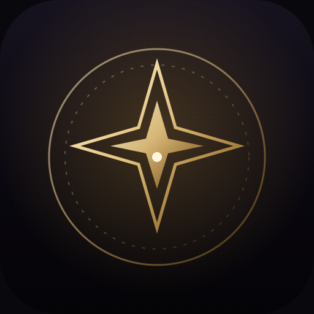

# AETHERIA

A mobile-first dark-fantasy MMORPG that runs in the browser, installs as a PWA
on Android, and is structured for Capacitor packaging and a real multiplayer
backend.

Three classes, two factions, eight realms, quests, crafting, gathering,
mounts, storage, cosmetics, and player trading over a real WebSocket server.



## Play

```bash
npm start            # http://localhost:3000
```

No build step and no runtime dependencies.

### Android

**Install as a PWA (works today).** Open the game in Chrome on Android and use
*Menu → Install app* (or the install icon in the address bar). The bundled
service worker caches the shell so the game keeps working offline.

**Build an installable debug APK.** Node 20+, the Android SDK
(`ANDROID_HOME`) and a JDK 17/21 are required. The Capacitor project is
already scaffolded in `android/`.

```bash
npm install
npm run android:apk      # web build + cap sync + ./gradlew assembleDebug
adb install -r android/app/build/outputs/apk/debug/app-debug.apk
```

`npm run android:apk` produces a **debug-signed APK** at
`android/app/build/outputs/apk/debug/app-debug.apk`. Debug APKs install
directly on a device or emulator. The GitHub Actions workflow
[`.github/workflows/android.yml`](.github/workflows/android.yml) builds the same
APK and uploads it as the `aetheria-debug-apk` artifact.

For a store build, open the project in Android Studio, add your release
keystore, and build a signed Bundle:

```bash
npm run android:open
# Android Studio: Build → Generate Signed Bundle / APK → Android App Bundle
```

You can also run the Capacitor steps manually:

```bash
npm run build:web
npx cap sync android
cd android && ./gradlew assembleDebug
```

`capacitor.config.json` sets the app id `com.aetheria.game`, the name
`AETHERIA`, and the `www` web directory produced by `npm run build:web`.
The manifest locks the activity to portrait, keeps the dark status/navigation
bars, and enables cleartext traffic for local `ws://` trade servers. Use
`wss://` and tighten/remove `android:usesCleartextTraffic` before shipping to
production.

After changing the web game, run `npm run android:sync` (or
`npm run android:apk` again) so the APK contains the new files.

## Controls

| Action | Touch | Keyboard |
| --- | --- | --- |
| Move | Left joystick | `WASD` / arrow keys |
| Attack | Sword button (hold to repeat) | `Space` |
| Skills | Three skill buttons | `1` `2` `3` |
| Potion | Potion button | `Q` |
| Mount | Mount button | `M` |
| Interact / talk / gather | Context button | `E` |
| Menu | Top-left avatar / menu | `Esc` |

## Systems

- **Classes:** Warrior (rage, heavy armor), Mage (mana, ranged), Assassin
  (energy, critical). Male and female characters for every class.
- **Factions:** Angel or Demon, reflected in wings, outfits, and character art.
- **Progression:** XP, levels, stat growth, skill unlocks, quest chapters,
  eight zones from Greendale to the Ashen Throne.
- **Equipment:** nine slots, rarities, boss stones with up to three bonuses,
  salvaging into Aether essence, and guaranteed fusion (4×T3 → T2, etc.).
- **Crafting:** forge a legendary item of your class; reroll boss stones.
  Critical chance is capped at **50%** everywhere.
- **Economy:** gold, gems, merchants, daily gift, storage (48 bag / 60 stash
  slots), and a cosmetic shop for outfits, hair, mounts, pets, effects, and
  wings.
- **Wings:** quest/shop-only, non-tradeable, non-fusionable, permanent.
- **Gathering:** herbs and crystals respawn in every zone.
- **Mounts:** faster travel, with quest-only and shop mounts.
- **Player trade:** real WebSocket transport (see below). No simulated players.
- **Language:** German and English, switchable in Settings and persisted
  independently of the save file.

## Multiplayer

The client seam is `src/net/tradeClient.js`. The reference backend is
`server/server.mjs` — a zero-dependency RFC 6455 WebSocket server.

```bash
npm run server           # ws://0.0.0.0:8787
npm run test:server      # protocol + anti-dupe integration test
```

In game: **Menu → Trade**, enter the server URL (`ws://localhost:8787` on the
same machine), connect, invite another player, build offers, both mark ready,
then confirm. The server validates offers, blocks untradeable items, requires
both sides to be ready, and completes a trade exactly once.

On Android, point the trade URL at the machine running the server, for example
`ws://192.168.1.20:8787`, and allow port 8787 through the host firewall. For
internet play, terminate TLS in front of the server and use `wss://`; the APK
ships with cleartext enabled only to keep local testing simple.

See [`server/README.md`](server/README.md) for the full protocol and production
notes.

## Saving

Everything is stored locally per browser profile:

| Key | Contents |
| --- | --- |
| `aetheria_save_v1` | hero, inventory, quests, progression, cosmetics |
| `aetheria_settings_v1` | language, audio, quality, joystick side, trade URL |
| `aetheria_trade_token` | stable trade identity |

Settings → *Reset save* clears the hero but keeps language and display
settings.

## Project layout

```
index.html                app shell + entry point
manifest.webmanifest      PWA manifest
sw.js                     offline service worker
src/main.js               application controller
src/core/                 game state, save, localization, audio, utils
src/data/                 classes, items, quests, zones, shop, NPCs
src/game/                 engine, procedural world/sprites/art
src/ui/                   menu, creation, HUD, panels
src/net/tradeClient.js    WebSocket transport seam
server/                   real trade server + protocol docs
android/                  Capacitor Android project
tools/                    static server, web build, APK build, server test
.github/workflows/        issue automation + Android APK build
icons/                    generated app icons
```

## Tests

```bash
npm run test:server
```

The gameplay, UI, save, and localization flows are validated with a Playwright
script against the static server (boot → character creation → world → combat →
every panel → save/reload → language switch).

## Credits

Art, sprites, maps, and audio cues are generated procedurally in code. No
third-party game assets are bundled.

---

<!-- omgithub:readme:start -->
## 🚀 Build, play, and remix with OMGithub

**Created using [OMGithub.com](https://go.ondev.store/).**

[](https://go.ondev.store/KyzenRyuZen/PlayGround)
[](https://github.com/KyzenRyuZen/PlayGround)

- 🎮 [Open the project](https://go.ondev.store/KyzenRyuZen/PlayGround).
- ✨ [Remix this project](https://go.ondev.store/KyzenRyuZen/PlayGround?remix=1).
- 💻 [Explore the source](https://github.com/KyzenRyuZen/PlayGround).
- 🛠️ [Check build runs](https://github.com/KyzenRyuZen/PlayGround/actions).
- 🐛 [Report an issue](https://github.com/KyzenRyuZen/PlayGround/issues).
- 👤 [Explore the creator's projects](https://go.ondev.store/KyzenRyuZen).
- 🌍 [Create with OMGithub](https://go.ondev.store/).
<!-- omgithub:readme:end -->
